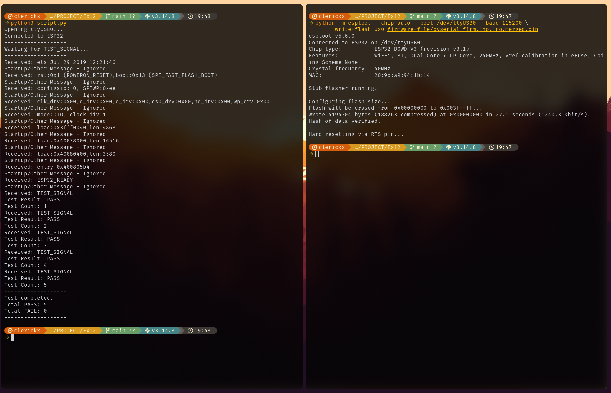
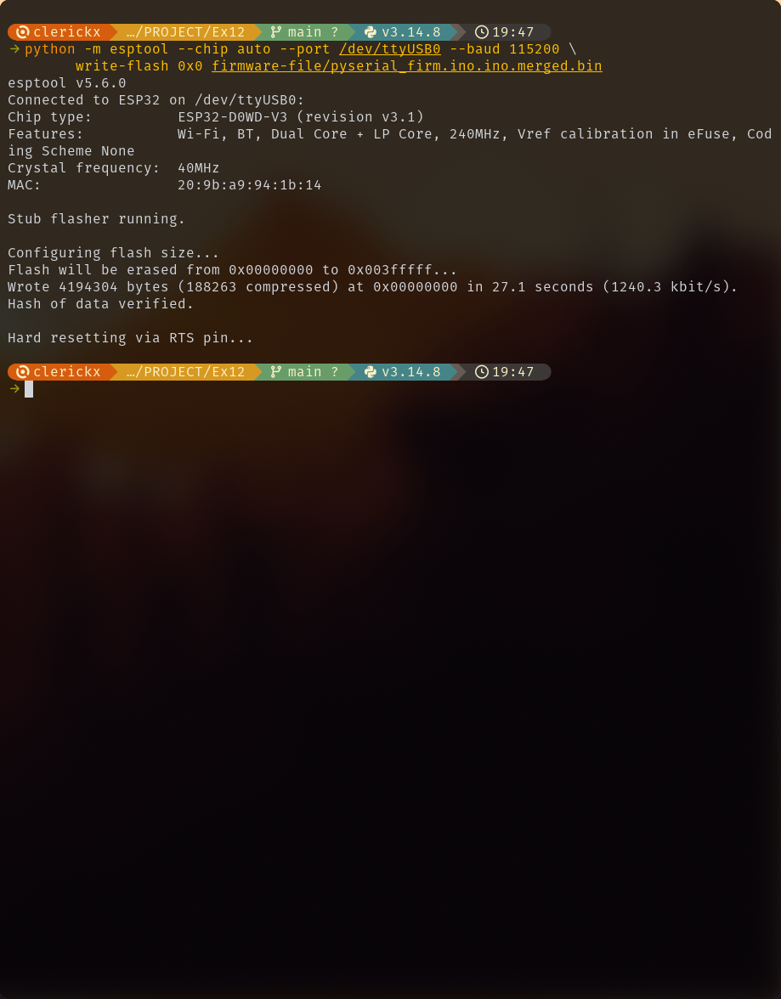
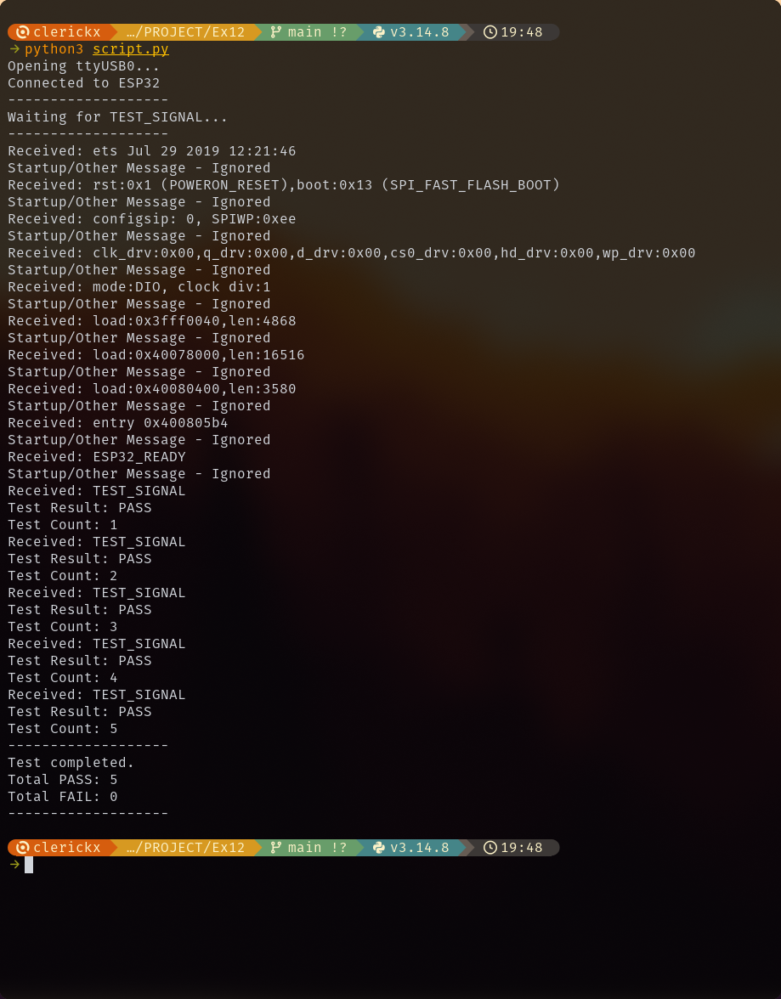

## Experiment 12: PYTHON SCRIPTING FOR EMBEDDED TEST AUTOMATION (PYSERIAL) AND SCRIPTED FIRMWARE FLASHING

### Side by side pyserial script & flash with esptool

### Flash window

### Pyserial window

