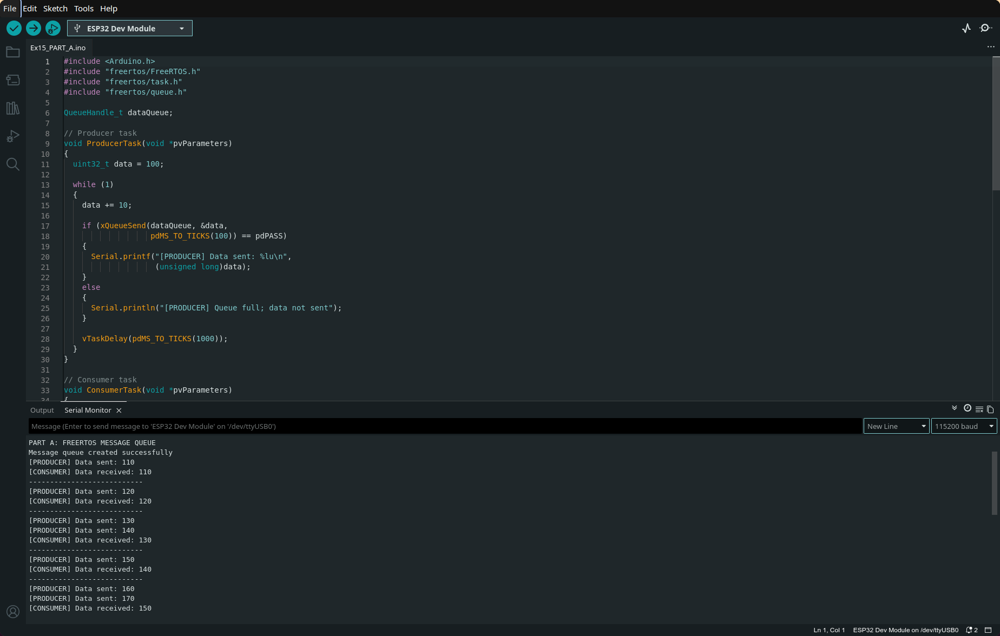
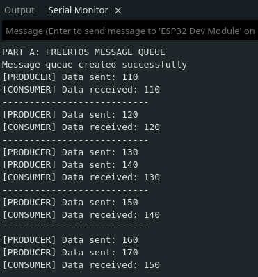
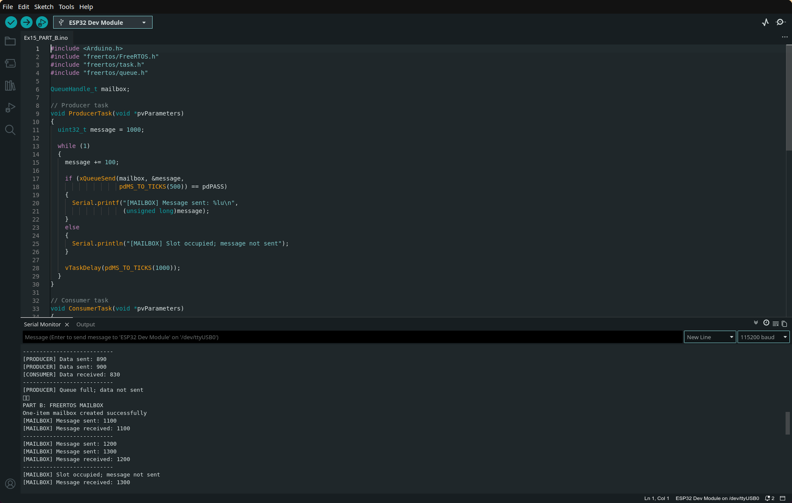
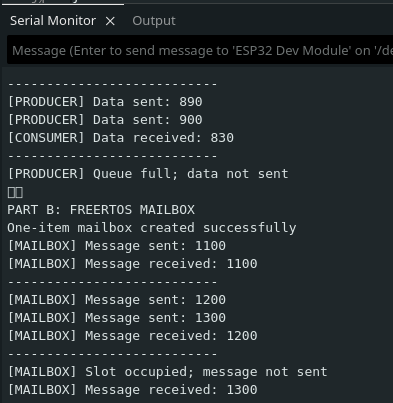
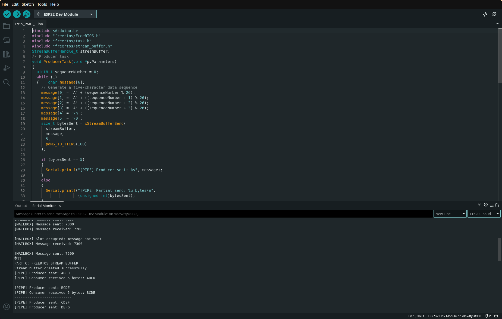
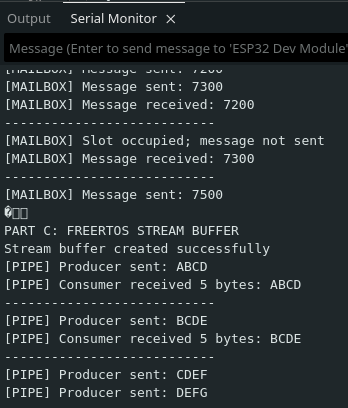

## Experiment 15: INTER-TASK COMMUNICATION USING MESSAGE QUEUES, MAILBOXES AND PIPES (STREAM BUFFERS) – PRODUCER–CONSUMER USING FREERTOS

### IDE Screenshot (PART A)

### Serial monitor (PART A)

### IDE Screenshot (PART B)

### Serial monitor (PART B)

### IDE Screenshot (PART C)

### Serial monitor (PART C)

